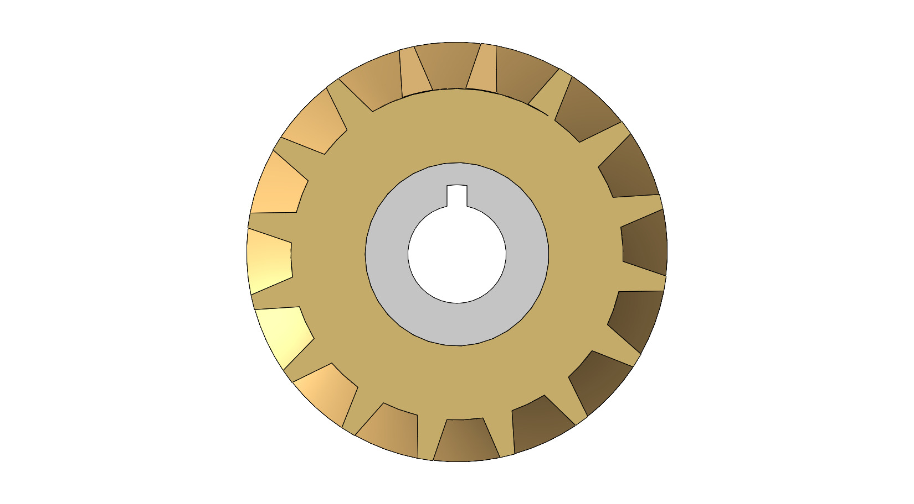
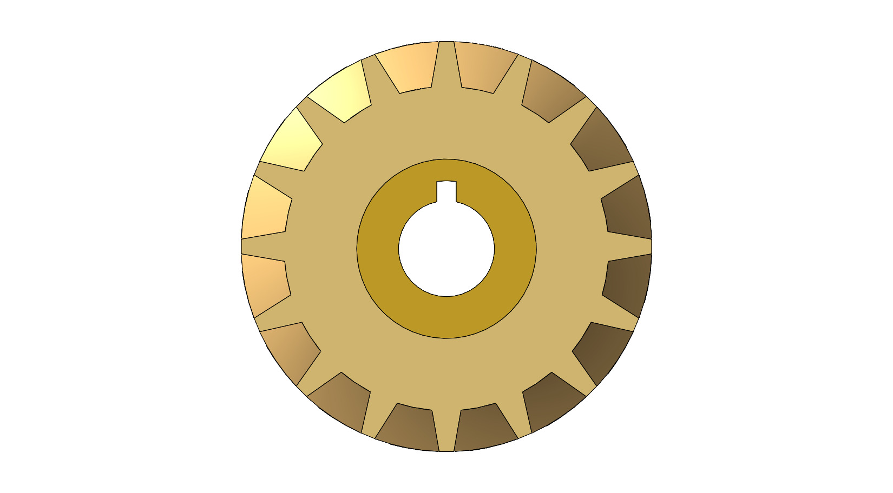
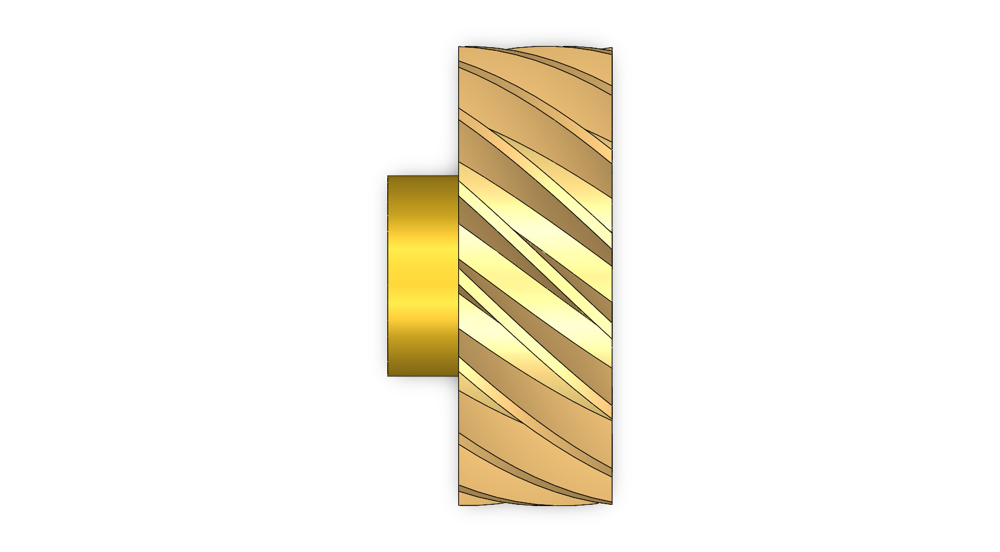
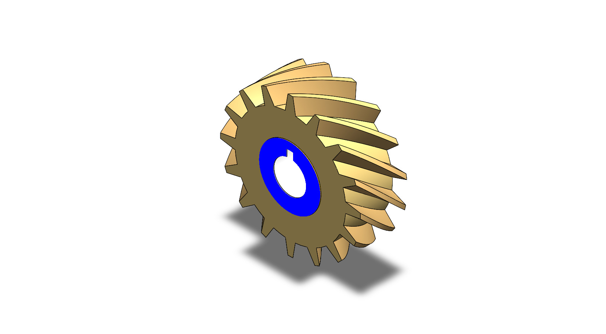
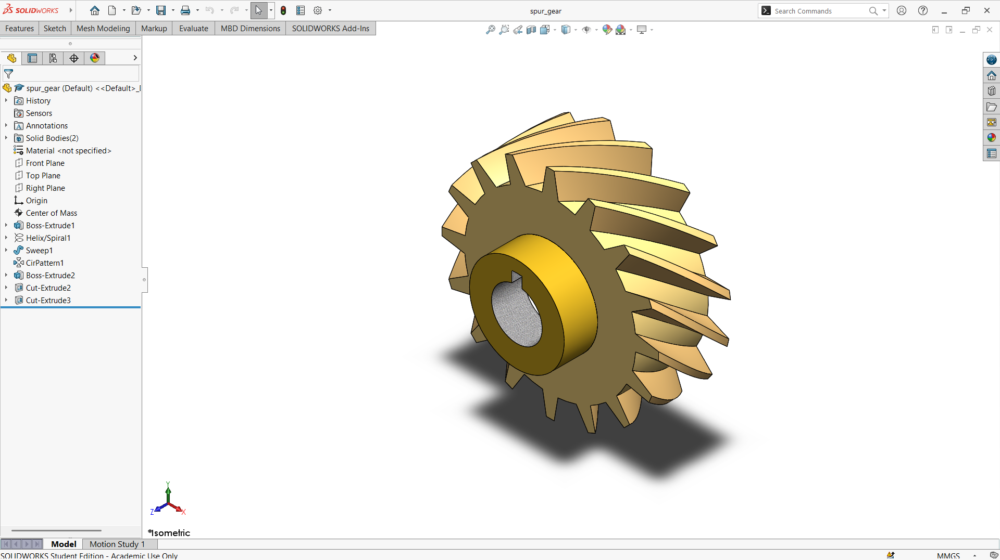

# A Keyed Gear with Angled Teeth and a Raised Hub

## Summary

Gears transmit motion and torque from one shaft to another, and their tooth geometry decides how smoothly and quietly they run. This project explores how a gear can be modeled computationally, from its tooth pattern to the hub that mounts it on a shaft.

The model is a toothed wheel with a raised central hub and a bore that has a keyway cut into it. The keyway lets the gear be locked to a shaft with a key, so that torque is transferred without slipping. The teeth are evenly spaced around the rim, and in the render they are cut at an angle across the face width rather than straight across it. The main challenge was to space the teeth uniformly around the rim and keep the hub, bore, and keyway concentric with the toothed wheel.

The gear was developed as a computational model in SolidWorks. The views below show the teeth, the hub, and the bore from every side, along with a section view of the part. This prototype is a base concept design that can be developed further into a gear with a true involute profile that meshes with a mating gear. Defining the gear dimensions properly is an important step before it can be used in a real mechanism.

---

## Computational Design

|   View    |                         Image                          |
| :-------: | :----------------------------------------------------: |
| Isometric |  |
|   Left    |            |
|   Right   |          |
|   Back    |            |
|   Front   |          |
|    Top    |              |
|  Bottom   |        |
|  Section  |      |

---

## Software Used

| Purpose |               Name                |
| :-----: | :-------------------------------: |
| Design  | SolidWorks 2024 (Student Version) |

---

## Feature Tree

| No  |       Name       |
| :-: | :--------------: |
| 01  |   Boss Extrude   |
| 02  |   Helix/Spiral   |
| 03  |      Sweep       |
| 04  | Circular Pattern |
| 05  |   Cut Extrude    |

---

## Feature Tree Image

---

## Applications [^1][^2][^3]

- Clocks and Electric Screwdrivers
- Household Appliances such as Washing Machines and Blenders
- Vehicle Gearboxes and Transmissions
- Conveyor Systems and Speed Reducers
- Gear Pumps and Motors
- Valve Operators for Torque Multiplication
- Rack and Pinion Linear Motion

---

## Design Limitations

The design of the spur gear was developed as a geometric prototype. That’s why the real-life design considerations, including a true involute profile from standard module and pressure angle, backlash, stress analysis, material and heat treatment, noise, lubrication, and feasibility, have not been included.

---

## Future Improvements

The gear should be generated from standard parameters such as module, pressure angle, and number of teeth, with a true involute tooth profile. A mating gear and an assembly should then be added to verify center distance, backlash, and the gear ratio. Bending-stress and contact-stress checks, a material and heat-treatment choice, and noise considerations would turn the model into an engineering design. Helical or herringbone versions could also be compared to reduce the noise of straight teeth.

---

## Acknowledgements

Special thanks to the [EasyCAD Solutions](https://www.youtube.com/@EasyCADSolutions) YouTube channel for the SolidWorks tutorials that helped in creating this design. I would also like to thank the [CAD CAM Tutorials](https://www.youtube.com/c/CADCAMTutorials) YouTube channel for its tutorials and learning resources, and [Mr. Md. Abdus Salam](https://mpe.iutoic-dhaka.edu/profile/salam/education), Drafting Instructor, Department of Mechanical and Production Engineering, Islamic University of Technology, for his guidance and support, and for his assistance in our ME 4210 3D Solid Modeling and Assembling lab course.

---

## References

[^1]: [What is a spur gear?](https://blog.igus.co.uk/what-is-a-spur-gear/)

[^2]: [What is a Spur Gear? Types, Benefits and Applications](https://mechtex.com/blog/what-are-spur-gears-types-bemefits-and-applications)

[^3]: [Dynatorque spur and miter gears](https://www.slb.com/valves/gear-operators/dynatorque-spur-and-miter-gears)
